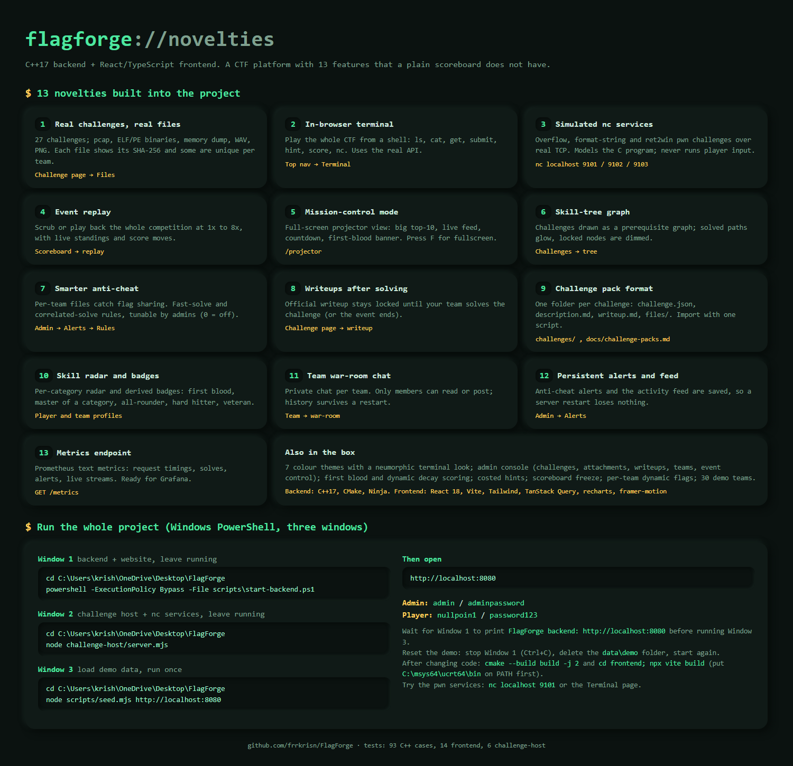

# FlagForge — CTF Competition Management System

A web-based Capture-The-Flag platform. An admin hosts an event, teams register and solve
challenges by submitting flags, and a live leaderboard ranks them — with real-CTF mechanics:
dynamic scoring, first blood, costed hints, per-team flags, anti-cheat and a scoreboard freeze.

- **Backend:** C++17 (pure `ctf_core` library + `cpp-httplib` REST server), built with CMake.
- **Frontend:** React 18 + TypeScript (strict), Vite, Tailwind — a themeable "hacker terminal" UI.
- **Persistence:** JSON files (no database server).

The full specification lives in [`docs/PLAYBOOK.md`](docs/PLAYBOOK.md). Contributor rules are in
[`CLAUDE.md`](CLAUDE.md). The frontend/backend API contract will live in `docs/api.md`.

---

## Prerequisites

| Tool | Version | For |
|---|---|---|
| C++ compiler | GCC 9+, Clang 10+, or MSVC 2019+ (C++17) | backend |
| CMake | ≥ 3.16 | backend |
| Node.js | 20 LTS (works on newer) | frontend |

CMake pulls all C++ dependencies automatically via `FetchContent` (cpp-httplib, nlohmann/json,
picosha2, Catch2 v3) — no manual installs needed. On Windows the server links `ws2_32`.

> **Windows note:** if you don't have a compiler yet, install one of:
> - MSVC via "Build Tools for Visual Studio" (Desktop development with C++), or
> - MinGW-w64 (there's a "MinGW Installer" shortcut on the Desktop), plus CMake from cmake.org.

---

## Build & run the backend

```bash
cmake -S . -B build -DCMAKE_BUILD_TYPE=Debug
cmake --build build -j
ctest --test-dir build --output-on-failure
./build/ctf_server --port 8080 --data data/runtime --web frontend/dist
```

Then check the health endpoint:

```bash
curl http://localhost:8080/api/health
# {"ok":true,"data":{"status":"up","version":"0.1.0"}}
```

## Build & run the frontend

```bash
cd frontend
npm ci
npm run dev          # Vite dev server on :5173, proxies /api -> :8080
# or, for a production bundle served by ctf_server:
npm run build        # writes frontend/dist
```

A convenience script builds both:

```bash
./scripts/build-all.sh
```

---

## Admin account

The admin is **the first user that registers** (or the admin created by the seed script). See
`docs/PLAYBOOK.md` §7.

## Seed a demo event

With the backend running on `:8080` (and an **empty** data dir, so the first user becomes admin),
populate a realistic event — 10 challenges, 12 teams with players, a spread of solves and first
bloods, a costed hint and a flag-sharing alert — entirely through the real API:

```bash
node scripts/seed.mjs http://localhost:8080
```

Then open the app. Log in as `admin` / `adminpassword`, or any team captain (e.g. `nullpoin1` /
`password123`).

The seed now creates **26 challenges and 30 teams** (`scripts/ctf-data.mjs`) and is safe to re-run:
it extends an existing event instead of failing. Extra options and companions:

```bash
node scripts/seed.mjs http://localhost:8080 --alerts   # also stage 3 flag-sharing incidents
node scripts/live.mjs http://localhost:8080            # keep solving/missing/hinting live (Ctrl+C to stop)
```

**Make the history look multi-day.** A fresh seed lands within a few seconds, so the timeline chart
is a vertical line. Stop the server, spread the history over ~3.5 days, then start it again:

```bash
node scripts/backdate.mjs data/runtime/state.json 3.5
```

(Anti-cheat alerts and the activity feed are saved with the rest of the state, so they survive a restart.)

## Challenge host and pwn services

The web and pwn challenges are backed by a separate, intentionally vulnerable process. Run it in a
third terminal (Node 22+):

```bash
node challenge-host/server.mjs
```

It serves the web challenges on `:9001` and three simulated `nc` services: `nc localhost 9101`
(Overflow 101), `9102` (Format Fiasco), `9103` (Return Home). They model the vulnerable C programs and
never execute player input. The in-browser Terminal talks to them too. Tests: `node --test challenge-host/services.test.mjs`.



## Feature tour

| Page | What it does |
|---|---|
| Challenges (`cards` / `tree`) | Filterable cards, or the prerequisite skill tree |
| Challenge page | Files with SHA-256 (some unique per team), hints, and the official writeup once you solve it |
| Terminal | `ls`, `cat`, `submit`, `hint`, `get`, `nc overflow` ... the whole CTF from a command line |
| Scoreboard, Replay | Live board and a scrubbable playback of the whole event |
| Projector (`/projector`) | Full-screen mission-control view for a big screen |
| Team | Members, invite code and a private war-room chat |
| Profiles | Skill radar per category and derived badges |
| Admin | Challenges (with attachments and writeups), teams, anti-cheat rules and alerts, event control |
| `/metrics` | Prometheus metrics for monitoring |

## Project status

Bootstrapped (Phase 0). See `docs/PLAYBOOK.md` §9.3 for the phase plan. This repo is being built
phase by phase; `main` is kept green (builds + tests pass).

## License

Coursework project. Not for production use.
