# Class Diagram

The full class model for FlagForge, covering every type in PLAYBOOK.md §5.1. Renders on
GitHub. Dependencies point **downward only**: `server` → `app` → `scoring`/`events`/`core` →
`persistence`. Core never includes server headers.

```mermaid
classDiagram
    direction TB

    %% ===================== Exceptions (ctf) =====================
    class CtfException {
        <<abstract>>
        +what() const char*
        #message_ string
    }
    class ValidationException
    class AuthException
    class PermissionException
    class NotFoundException
    class DuplicateSolveException
    class TeamFullException
    class ChallengeLockedException
    class CooldownException
    class CompetitionClosedException
    class InvalidFlagFormatException
    CtfException <|-- ValidationException
    CtfException <|-- AuthException
    CtfException <|-- PermissionException
    CtfException <|-- NotFoundException
    CtfException <|-- DuplicateSolveException
    CtfException <|-- TeamFullException
    CtfException <|-- ChallengeLockedException
    CtfException <|-- CooldownException
    CtfException <|-- CompetitionClosedException
    CtfException <|-- InvalidFlagFormatException

    %% ===================== Users (ctf::core) =====================
    class Role {
        <<enumeration>>
        Player
        Admin
    }
    class User {
        <<abstract>>
        -id_ UserId
        -username_ string
        -email_ string
        -bio_ string
        -avatarSeed_ string
        -themePrefs_ string
        -passwordHash_ string
        -salt_ string
        +role() Role*
        +verifyPassword(pw) bool
        +setPassword(pw) void
    }
    class Player {
        -teamId_ optional~TeamId~
        -personalSolves_ int
        +role() Role
    }
    class Admin {
        +role() Role
    }
    User <|-- Player
    User <|-- Admin
    User ..> Role

    %% ===================== Team & value types =====================
    class Team {
        -id_ TeamId
        -name_ string
        -captainId_ UserId
        -memberIds_ vector~UserId~
        -inviteCode_ string
        -solved_ vector~SolveRecord~
        -hintUnlocks_ vector~HintUnlock~
        -badges_ set~Badge~
        +kMaxSize$ size_t
        +addMember(id) void
        +removeMember(id) void
        +isFull() bool
        +operator<(other) bool
        +operator+=(rec) Team&
    }
    class SolveRecord {
        +challengeId ChallengeId
        +playerId UserId
        +timestamp TimePoint
        +firstBlood bool
    }
    class HintUnlock {
        +challengeId ChallengeId
        +hintId HintId
        +cost int
        +timestamp TimePoint
    }
    class Hint {
        -id_ HintId
        -text_ string
        -cost_ int
        +cost() int
        +text() string
    }
    class Submission {
        -teamId_ TeamId
        -playerId_ UserId
        -challengeId_ ChallengeId
        -timestamp_ TimePoint
        -result_ SubmitResult
        -totalCount_$ size_t
        +operator==(other) bool
    }
    class Announcement {
        +id AnnouncementId
        +title string
        +body string
        +severity Severity
        +timestamp TimePoint
    }
    Team "1" o-- "*" Player : aggregates (ids)
    Team "1" *-- "*" SolveRecord : owns
    Team "1" *-- "*" HintUnlock : owns

    %% ===================== Challenges (ctf::core) =====================
    class Category {
        <<enumeration>>
        Web
        Crypto
        Forensics
        Reverse
        Pwn
        Misc
    }
    class Difficulty {
        <<enumeration>>
        Easy
        Medium
        Hard
    }
    class SubmitResult {
        <<enumeration>>
        Correct
        Wrong
        AlreadySolved
        Locked
        Cooldown
        Closed
        FlagSharing
    }
    class Challenge {
        <<abstract>>
        -id_ ChallengeId
        -title_ string
        -description_ string
        -category_ Category
        -difficulty_ Difficulty
        -basePoints_ int
        -prerequisites_ vector~ChallengeId~
        -hints_ vector~Hint~
        -visible_ bool
        -scoring_ unique_ptr~IScoringStrategy~
        -nextId_$ int
        +checkFlag(ctx, input) bool*
        +currentPoints(ctx) int
    }
    class StaticChallenge {
        -flagHash_ string
        +checkFlag(ctx, input) bool
    }
    class DynamicFlagChallenge {
        -flagPrefix_ string
        +expectedFlagFor(teamId) string
        +checkFlag(ctx, input) bool
    }
    class MultiFlagChallenge {
        -flagHashes_ vector~string~
        +checkFlag(ctx, input) bool
    }
    class ChallengeFactory {
        +create(spec)$ unique_ptr~Challenge~
    }
    Challenge <|-- StaticChallenge
    Challenge <|-- DynamicFlagChallenge
    Challenge <|-- MultiFlagChallenge
    Challenge "1" *-- "*" Hint : owns (composition)
    Challenge "1" *-- "1" IScoringStrategy : owns strategy
    Challenge ..> Category
    Challenge ..> Difficulty
    ChallengeFactory ..> Challenge : creates

    %% ===================== Scoring (ctf::scoring) =====================
    class IScoringStrategy {
        <<interface>>
        +pointsFor(ctx) int*
        +clone() unique_ptr~IScoringStrategy~*
    }
    class ScoringContext {
        +basePoints int
        +minPoints int
        +decay int
        +solveCount int
        +isFirstBlood bool
    }
    class StaticScoring {
        +pointsFor(ctx) int
    }
    class DecayScoring {
        +pointsFor(ctx) int
    }
    class FirstBloodScoring {
        -inner_ unique_ptr~IScoringStrategy~
        +pointsFor(ctx) int
    }
    IScoringStrategy <|.. StaticScoring
    IScoringStrategy <|.. DecayScoring
    IScoringStrategy <|.. FirstBloodScoring
    FirstBloodScoring o-- IScoringStrategy : decorates
    IScoringStrategy ..> ScoringContext

    class Scoreboard {
        +compute(teams, challenges) vector~RankRow~
        +snapshot(at) ScoreboardSnapshot
        +timeline(topN) vector~TeamTimeline~
    }
    class RankRow {
        +teamId TeamId
        +rank int
        +score int
        +solves int
        +lastSolveAt TimePoint
    }
    Scoreboard ..> RankRow
    Scoreboard ..> Team
    Scoreboard ..> Challenge

    %% ===================== Events (ctf::events) =====================
    class EventType {
        <<enumeration>>
        Solve
        FirstBlood
        WrongAttempt
        HintUnlocked
        TeamCreated
        TeamJoined
        EventStarted
        EventPaused
        EventEnded
        FlagSharing
        CooldownTriggered
        Announcement
    }
    class Event {
        +type EventType
        +timestamp TimePoint
        +teamId optional~TeamId~
        +challengeId optional~ChallengeId~
        +message string
    }
    class IEventObserver {
        <<interface>>
        +onEvent(e) void*
    }
    class EventBus {
        -observers_ vector~weak_ptr~IEventObserver~~
        +subscribe(obs) void
        +unsubscribe(obs) void
        +publish(e) void
    }
    class ActivityFeed {
        -ring_ deque~Event~
        +onEvent(e) void
        +recent(sinceId) vector~Event~
    }
    class EventLog {
        -entries_ vector~Event~
        +onEvent(e) void
    }
    class AntiCheatMonitor {
        -alerts_ vector~Alert~
        +onEvent(e) void
        +openAlerts() vector~Alert~
        +dismiss(id) void
    }
    class Alert {
        +id AlertId
        +kind AlertKind
        +status AlertStatus
        +evidence string
    }
    IEventObserver <|.. ActivityFeed
    IEventObserver <|.. EventLog
    IEventObserver <|.. AntiCheatMonitor
    EventBus o-- IEventObserver : notifies
    EventBus ..> Event
    AntiCheatMonitor *-- Alert

    %% ===================== Persistence (ctf::persistence) =====================
    class Repository~T~ {
        <<template>>
        -items_ unordered_map~Id,T~
        +add(item) void
        +get(id) T&
        +remove(id) void
        +findIf(pred) vector~T~
        +all() vector~T~
    }
    class JsonStore {
        -path_ string
        +save(json) void
        +load() json
    }
    JsonStore ..> Repository : persists

    %% ===================== App & Server =====================
    class CTFManager {
        <<facade>>
        -mutex_ shared_mutex
        -users_ Repository~User~
        -teams_ Repository~Team~
        -challenges_ Repository~Challenge~
        -bus_ EventBus
        -scoreboard_ Scoreboard
        -state_ EventState
        +registerUser(...) 
        +login(...)
        +submitFlag(...)
        +unlockHint(...)
        +scoreboard(...)
    }
    class SessionManager {
        -sessions_ unordered_map~Token,Session~
        +create(userId) Token
        +lookup(token) optional~UserId~
        +revoke(token) void
    }
    class ApiRouter {
        +registerRoutes(server, mgr) void
    }
    CTFManager *-- Repository : owns
    CTFManager *-- EventBus : owns
    CTFManager *-- Scoreboard : owns
    CTFManager ..> Challenge : checkFlag (polymorphic)
    CTFManager ..> IScoringStrategy : pointsFor (polymorphic)
    ApiRouter ..> CTFManager : delegates
    ApiRouter ..> SessionManager : auth
```

## Notes
- **Composition** (filled diamond `*--`): `Challenge` owns its `Hint`s and its `IScoringStrategy`;
  `CTFManager` owns the repositories, bus and scoreboard; a `Team` owns its solve/hint records.
- **Aggregation** (open diamond `o--`): a `Team` references `Player`s by id; `EventBus` holds
  non-owning `weak_ptr` observers.
- **Realization** (dashed `<|..`): concrete types implement the pure-virtual interfaces
  `IScoringStrategy` and `IEventObserver`.
- **Decorator**: `FirstBloodScoring` both *is-an* `IScoringStrategy` and *has-an* inner one.
