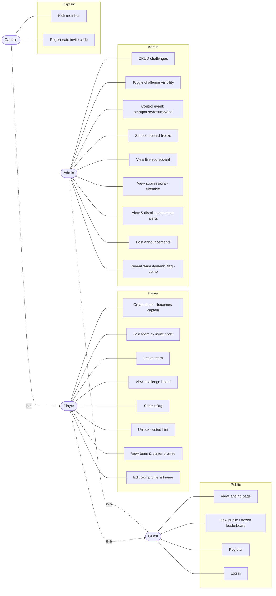

# Use-Case Diagram

Actors and their use cases (PLAYBOOK.md §2.3). Roles are cumulative: a Captain is a Player, a
Player is a Guest.

## Notes
- **Guest → Player**: registering and joining/creating a team promotes a guest to a player.
- **Player → Captain**: creating a team, or being the first member, makes the player captain.
- **Admin** is a distinct role (first registered user or seeded). Admin does not compete but can
  reveal per-team flags for the demo/anti-cheat showcase.
